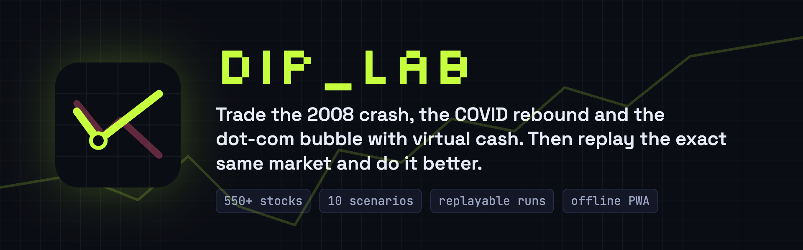
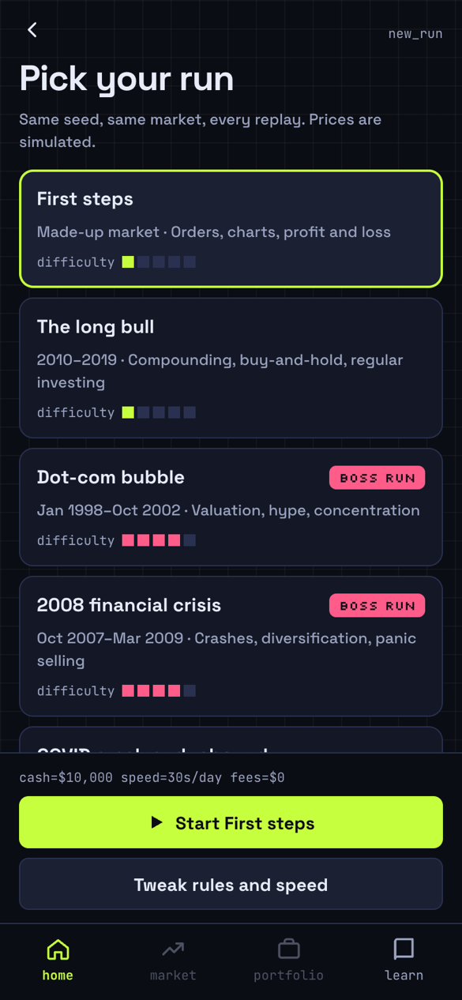
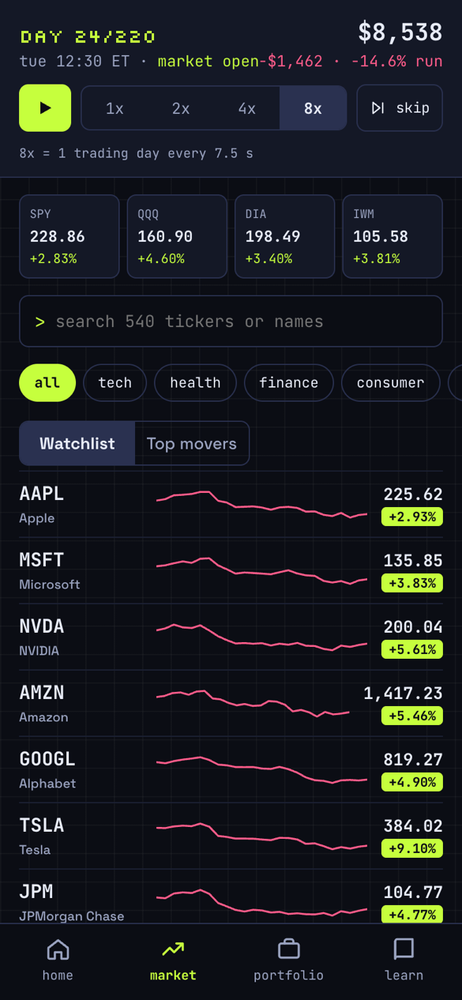
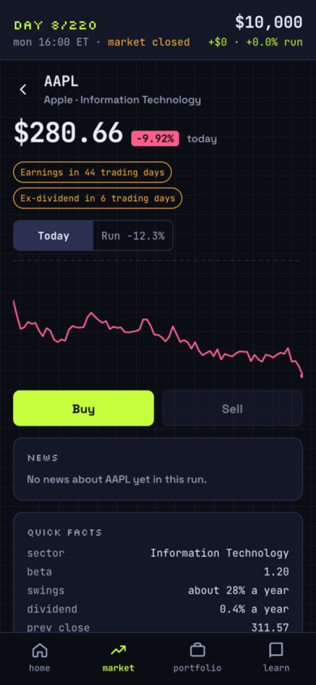
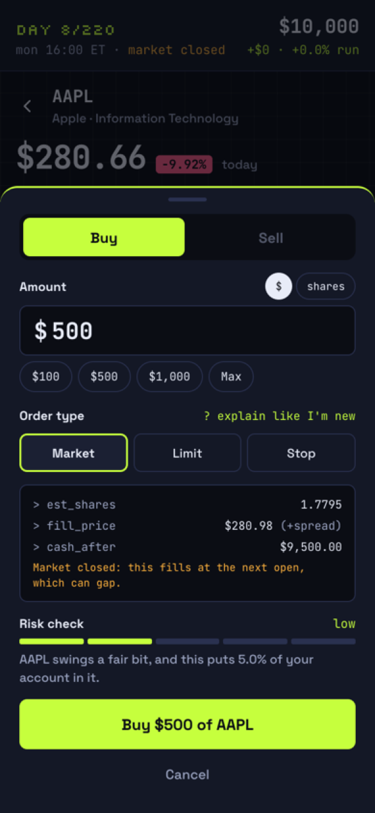
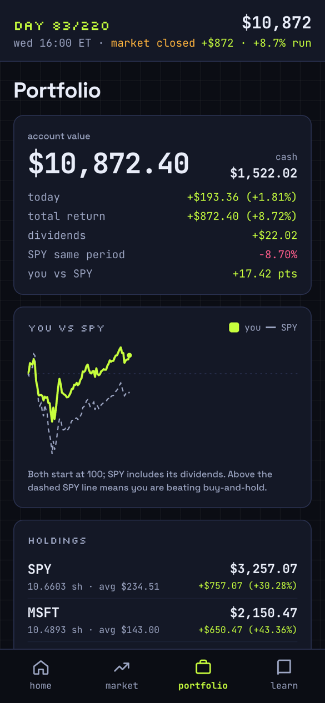
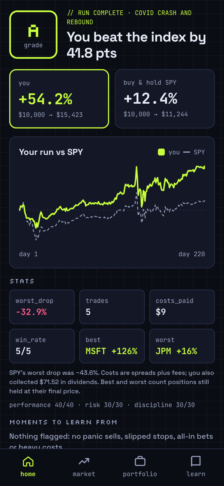
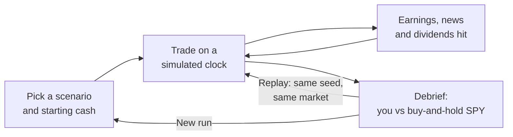
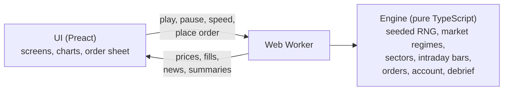

<div align="center">



### Learn how the stock market works by living through its best and worst days.

[](https://prataapms.github.io/dip-lab/)

[](https://github.com/PrataapMS/dip-lab/actions/workflows/ci.yml)
[](https://github.com/PrataapMS/dip-lab/actions/workflows/deploy.yml)


[](LICENSE)


[Play](https://prataapms.github.io/dip-lab/) ·
[Screens](#screens) ·
[Features](#features) ·
[Scenarios](#scenarios) ·
[Install](#install-it-like-an-app) ·
[FAQ](#faq) ·
[Develop](#run-it-locally) ·
[Roadmap](docs/ROADMAP.md) ·
[License](#license)

</div>

> [!IMPORTANT]
> Every price in Dip Lab is **simulated**. Historical scenarios follow the rough shape of each
> period but use no real price data. Nothing here is investment advice.

## Why Dip Lab?

Reading about a crash is not the same as sitting through one with your money on the line.
Dip Lab hands you virtual cash, drops you into a market (a calm quarter, the 2008 crisis, the
COVID crash, a meme-stock squeeze, ...) and lets you trade about 550 well-known US stocks and
ETFs on a clock you can speed up or pause.

When the run ends you get an honest debrief: **did you beat simply buying the index and doing
nothing?** Then comes the twist. Hit **Replay** and you get *exactly the same market* again,
same prices, same headlines, same earnings surprises. The only thing that changes is you.

- **No sign-up, no ads, no tracking.** Everything runs in your browser.
- **Works offline.** After the first visit it needs no network at all.
- **Trading in under a minute.** One-tap amounts, plain-English orders ("Buy $500 of AAPL").
- **Graded on process, not luck.** An all-in bet that happens to pay off still gets marked down.

## Screens

<table>
  <tr>
    <td align="center" width="33%"><br><b>Pick your run</b><br><sub>Nine scenarios plus a custom market</sub></td>
    <td align="center" width="33%"><br><b>Market</b><br><sub>Live clock, indexes, search, movers</sub></td>
    <td align="center" width="33%"><br><b>Stock</b><br><sub>Intraday chart, events, quick facts</sub></td>
  </tr>
  <tr>
    <td align="center"><br><b>Order sheet</b><br><sub>Plain-English preview and risk check</sub></td>
    <td align="center"><br><b>Portfolio</b><br><sub>Your equity curve vs the index</sub></td>
    <td align="center"><br><b>Debrief</b><br><sub>Grade, stats and replay</sub></td>
  </tr>
</table>

## How a run works



1. **Pick your run.** Choose a scenario, starting cash ($1k to $1M) and fees, or build a custom market.
2. **Trade.** Market hours tick by in 5-minute bars. Play, pause, skip to the close, or change speed (1x to 8x).
3. **React.** Earnings beats and misses, company news and scenario headlines move prices; dividends land in your cash.
4. **Get graded.** See your return next to buy-and-hold SPY (with dividends), your worst drop, costs and the moments worth learning from.
5. **Replay.** Same seed, same market. Try the plan you wish you'd had.

## Features

### Available now

| Area | What you get |
| --- | --- |
| **Stocks** | ~550 S&P 500 and popular Nasdaq names, plus index and sector ETFs (SPY, QQQ, DIA, IWM, ...). Search, sector filter, watchlist, top movers. |
| **Orders** | Market, limit and stop orders. Buy by dollars or shares, fractional shares, day or until-cancelled. "Explain like I'm new" on every order type. |
| **Realistic fills** | Bid/ask spread, optional commission ($0, $1 or $5 a trade), overnight gaps, stops that slip through gaps. |
| **Risk check** | Every order shows how much of your account it puts at risk before you confirm. |
| **Clock** | Real NYSE calendar with weekends and holidays skipped. Play, pause, skip to the close, 1x / 2x / 4x / 8x speed. |
| **Events** | Quarterly earnings with beats and misses, company news, scenario headlines, quarterly dividends with ex-dates. |
| **Day summary** | At each close: you vs SPY, best and worst holding, the day's headline. |
| **Portfolio** | Account value, cash, profit and loss, dividends received, and your equity curve against SPY. |
| **Debrief** | A to F grade, return vs SPY, worst drawdown, win rate, costs paid, best and worst positions, and flagged moments. |
| **Replay** | Rerun any market with the same seed. Share a seed and a friend gets the same market. |
| **Offline app** | Installable PWA. Fonts and data ship inside the app; no network calls at runtime. |

### Coming next

- **Learn:** guided first trade, glossary tooltips, short lessons and challenges.
- **Rewards:** XP, levels and ranks, daily quests, streaks and badges, unlockable scenarios.
- **Replay a moment:** jump straight back to the day of a mistake and try again.
- **More tools:** margin with margin calls, short selling.
- **Polish:** autosave and save slots, export and import, settings, slower clock speeds.

See the full [roadmap](docs/ROADMAP.md).

## Scenarios

| Scenario | Period | Difficulty | What it teaches |
| --- | --- | :---: | --- |
| First steps | Made-up, 3 months | ■□□□□ | Orders, charts, profit and loss |
| The long bull | 2010 to 2019 | ■□□□□ | Compounding, buy-and-hold, regular investing |
| Sideways chop | Made-up, 1 year | ■■□□□ | Overtrading and fees |
| Earnings season | Made-up, 3 months | ■■□□□ | Price gaps, beats vs misses, slippage |
| COVID crash and rebound | Feb to Dec 2020 | ■■■□□ | How fast crashes happen, selling at the bottom |
| 2022 rate shock | Jan to Dec 2022 | ■■■□□ | Growth vs value, interest rates, bear-market rallies |
| Dot-com bubble 💀 | Jan 1998 to Oct 2002 | ■■■■□ | Valuation, hype, concentration |
| 2008 financial crisis 💀 | Oct 2007 to Mar 2009 | ■■■■□ | Crashes, diversification, panic selling |
| Meme squeeze 💀 | Made-up, 6 weeks | ■■■■■ | Hype, short squeezes, extreme volatility |
| Custom | Any start from 1998 to 2024, up to 3 years | your call | Free exploration: pick the mood, length and seed |

💀 = boss run. Historical scenarios pass through the real period's major turning points (for
example the March 2020 low) while every individual price path is simulated.

## How you're graded

Your grade is about **how** you invested, not only how much you made.

| Part | Weight | What counts |
| --- | :---: | --- |
| Performance | 40% | Your return compared with buy-and-hold SPY over the same days |
| Risk | 30% | Your worst drawdown compared with the market's |
| Discipline | 30% | Fees and spreads paid, panic-selling near lows, concentration |

Putting 50% or more of your account into one stock caps your grade, and so does sitting mostly
in cash. Lucky all-in bets don't get an A.

## Install it like an app

Dip Lab is a Progressive Web App: open it once and it keeps working offline.

| Device | How |
| --- | --- |
| **iPhone / iPad** | Open the [game](https://prataapms.github.io/dip-lab/) in Safari, tap **Share**, then **Add to Home Screen**. |
| **Android** | Open it in Chrome, tap the **⋮** menu, then **Install app** (or **Add to Home screen**). |
| **Desktop** | In Chrome or Edge, click the install icon at the right of the address bar. |

## FAQ

<details>
<summary><b>Is this real market data?</b></summary>

No. Every price is generated by a simulation engine. Historical scenarios are shaped to follow
the rough path of the real period (how far and how fast the market fell, when it bottomed) but
individual stock prices, earnings results and news are simulated.
</details>

<details>
<summary><b>Is this investment advice?</b></summary>

No. Dip Lab is a learning game. It teaches how markets and orders behave, not what to buy.
</details>

<details>
<summary><b>Do I need an account or an internet connection?</b></summary>

No account, ever. You need a connection only for the first visit; after that the whole app,
including all stock data, is cached on your device.
</details>

<details>
<summary><b>Where is my data stored?</b></summary>

On your device only. Nothing is sent anywhere. Runs currently live in memory for the session;
autosave and save slots are on the roadmap.
</details>

<details>
<summary><b>Why does replay give me exactly the same market?</b></summary>

Every run is built from a seed. The same seed and options always produce the same prices,
headlines and earnings results, so you can compare two strategies fairly or send a seed to a
friend and race them on the same market.
</details>

<details>
<summary><b>Are the companies and tickers real?</b></summary>

The list of ~550 companies is based on well-known US stocks and ETFs, with approximate sectors,
volatility and dividend yields. A few tickers may be out of date, and the Meme squeeze scenario
adds a fictional company.
</details>

## Run it locally

Requires **Node 20+**.

```bash
git clone https://github.com/PrataapMS/dip-lab.git
cd dip-lab
npm ci
npm run dev        # http://localhost:5173
```

| Command | What it does |
| --- | --- |
| `npm run dev` | Start the dev server with hot reload |
| `npm test` | Run the Vitest suite once (`npm run test:watch` to watch) |
| `npm run typecheck` | Type-check with `tsc --noEmit` |
| `npm run build` | Production build into `dist/`, including the service worker |
| `npm run preview` | Serve the production build locally |
| `npm run lint` | Lint with [Biome](https://biomejs.dev) (`npm run format` formats) |
| `npm run test:coverage` | Run the tests with a coverage report |
| `npm run check:dist` | Check the build's PWA files and size budget |
| `npm run test:e2e` | Play a first trade in Chrome against the build, then reload offline (needs `npm i --no-save playwright-core@1.59.1` and a prior `npm run build`) |

CI runs on pushes to `main` and on pull requests: lint, typecheck, tests with coverage, build,
size budget, then the end-to-end smoke test.

### How it's built



- **Engine** (`src/engine/`): pure, deterministic TypeScript with no DOM access. All randomness
  flows from one seed, so every run is reproducible and covered by tests.
- **Worker** (`src/worker/`): runs the engine off the main thread so the UI stays smooth at 8x.
- **UI** (`src/ui/`): Preact screens with a hash router; renders state and sends commands.
- **Data** (`src/data/universe.json`): the stock and ETF universe, bundled and precached.

```
src/
├── engine/    market simulation, calendar, orders, account, events, debrief
├── worker/    Web Worker that hosts the engine
├── ui/        screens, charts, order sheet, formatting helpers
├── data/      stock and ETF universe
└── styles/    design tokens and global styles
```

### Releases

- **GitHub Pages:** deploys automatically when the major version in `package.json` goes up on
  `main` (for example `0.x` to `1.0.0`) and CI has passed, or manually from the Actions tab.
  Each deploy is tagged `vX.Y.Z` with a GitHub Release.
- **Netlify:** manual only. Run **Deploy to Netlify** from the Actions tab and pick `preview`
  or `production`. It needs the repository secrets `NETLIFY_AUTH_TOKEN` and `NETLIFY_SITE_ID`;
  build settings live in `netlify.toml`.

## Roadmap

| Phase | Delivers | Status |
| --- | --- | :---: |
| 0 | Project setup, app shell, seeded market paths | ✅ |
| 1 | Market engine: moods, sectors, intraday prices, trading calendar, stock list | ✅ |
| 2 | Trading screens: market, stock, order sheet, portfolio | ✅ |
| 3 | All scenarios, news and events, dividends, debrief and grades | ✅ |
| 4 | Tutorial, glossary, lessons, challenges, XP and badges, margin and shorts | 🚧 |
| 5 | Saves, settings, install prompt, offline polish, performance | ⏳ |

Details in [docs/ROADMAP.md](docs/ROADMAP.md). Ideas and bug reports are welcome in
[Issues](https://github.com/PrataapMS/dip-lab/issues).

## License

Dip Lab is free software: you can redistribute it and/or modify it under the terms of the
[GNU General Public License](LICENSE) as published by the Free Software Foundation, either
version 3 of the License, or (at your option) any later version.

It is distributed in the hope that it will be useful, but **without any warranty**; without
even the implied warranty of merchantability or fitness for a particular purpose. See the
[LICENSE](LICENSE) file for details.

Copyright © 2026 [PrataapMS](https://github.com/PrataapMS).

### Third-party components

| Component | License |
| --- | --- |
| [Preact](https://github.com/preactjs/preact) | MIT |
| [Space Grotesk](https://github.com/floriankarsten/space-grotesk), [JetBrains Mono](https://github.com/JetBrains/JetBrainsMono), [Silkscreen](https://github.com/googlefonts/silkscreen) (via Fontsource) | SIL Open Font License 1.1 |

<div align="center">
<sub>Prices are simulated. Nothing here is investment advice.</sub>
</div>
